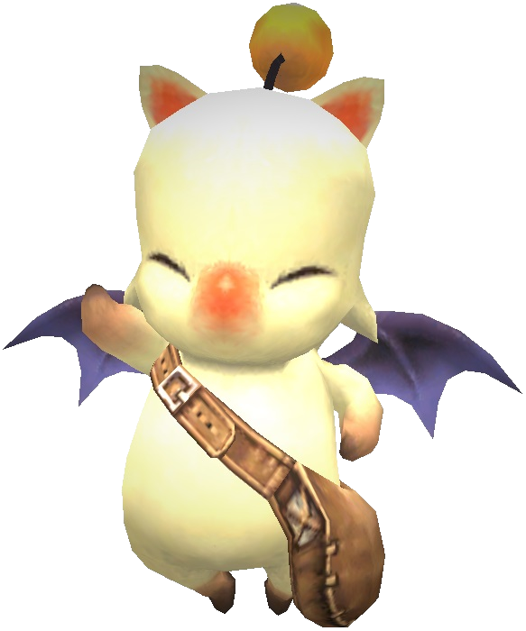

# QuestLens 

Quest and mission tracking for **Phoenix XI**, with guides, saved notes, item uses, and nearby NPC hints.

**0.2.18 · Testing release**  
By **Zarianna (100% vibe coded)**

## Install or update

Requires **Ashita v4 on 64-bit Windows**. An internet connection is needed to download guides and reference updates.

1. Download **questlens-0.2.18.zip** from [Releases](https://github.com/Nanastack/QuestLens/releases).
2. Extract it into your Ashita `addons` folder. The main file should be `addons/questlens/questlens.lua`.
3. Run `/addon load questlens`, then `/ql` to open it. If QuestLens is already loaded, use `/ql reload` instead.

**Updating?** Keep your existing `settings` and `cache` folders. They contain your saved preferences, pins, highlights, notes, and downloaded guides. Keep all the included addon folders together; no extra Python installation is needed.

If you download the repository instead, place its contents directly inside `addons/questlens`.

**Empty quest list after loading?** Zone once. QuestLens reads progress updates the game sends naturally. **Refresh display** redraws information it already has; it cannot retrieve missing progress.

## Start here

- **Read a guide:** click a quest or mission. Hover over linked items for a preview, or click to see more. Maps and related pages open inside QuestLens; the labeled wiki buttons open your browser.
- **Pin what you’re working on:** click the empty box beside a quest or on its Information page. Use **Pinned** to see your saved list.
- **Tidy your list:** the circle/slash moves a quest to **Ignored**. Use the green restore arrow to bring it back.
- **Check your progress:** switch between active, unaccepted, and completed entries. Completion labels appear when QuestLens has received your character’s progress.

If a page has **Pin as quest**, you can save it even when QuestLens cannot identify it automatically. Its completion may need to be checked manually.

## Highlights and personal notes

Open a guide and enable **Highlight text**. Choose yellow, green, blue, or pink, then drag across the text.

- Leave **Keep previous** checked to keep several highlights. Uncheck it to replace them with your next selection.
- Use **Undo last highlight** or **Clear guide highlights** to remove marks.
- Turn highlighting off to click links or move the Information window.
- Write reminders in **My Notes** below the guide—for example, which item an NPC asked you to bring.

Notes and highlights save automatically for each character and guide. Refreshing a guide does not overwrite your notes. If its text changes, highlights that no longer match are hidden rather than moved onto different instructions.

##  Find uses for your items

Open **Quest Items**, choose a container, and select an item to see known quests that use it. **Complete** and **Repeatable** labels appear when that information is available.

In a guide’s **Related items** section:

- A green check means you own an item recorded as a requirement for that quest.
- Other owned items show an **Owned** label without a check.
- Locations show Inventory or the loaded storage containers holding the item.

These checks show ownership, not necessarily the full amount needed for the current step. Read the walkthrough for quantities and alternative turn-ins. Storage that has not loaded cannot be counted reliably.

## Nearby NPC hints

Enable **Quest markers** to show a moogle near supported quest NPCs within **9 yalms**.

| Badge beside the moogle | Meaning |
| --- | --- |
| Yellow question mark | A known quest you have not accepted or completed |
| Yellow repeat arrows | A repeatable quest; items are missing or its turn-in has not been verified |
| Green hand | A verified repeatable turn-in has enough items in main Inventory |

**Ready-to-trade markers count main Inventory only.** Items in Satchel, Mog Safe, or other storage do not make the marker ready. Where supported, any one valid alternative turn-in counts.

A marker is a hint: fame, cooldowns, or other requirements may still prevent an NPC from offering the quest.

NPC greetings are enabled by default within **12 yalms**. You can turn them off or change the delay in **Debug**. Greetings are local visual effects; they are not sent to the game server. Leave marker previews and extended test range off during normal play.

## Useful commands

| Command | Action |
| --- | --- |
| `/ql` | Open or close the tracker |
| `/ql inventory` | Open Quest Items |
| `/ql lookup <name>` | Look up a quest, item, or zone |
| `/ql received` | Reopen recent quest notices |
| `/ql reload` | Reload QuestLens |
| `/ql refresh` | Rebuild the display from available progress |
| `/ql updates` | Check for supported quest reference updates |
| `/ql help` | Show all commands |

## Coverage and guides

This is a testing release aimed at Phoenix content **up to and including Treasures of Aht Urhgan**. Quest, item-use, and NPC coverage is incomplete. A missing match does not mean an item has no quest use, and a marker does not guarantee quest availability.

QuestLens prefers **Phoenix Wiki**. If a guide is missing or has no walkthrough, supported quests and missions can fall back to **BG-Wiki**. BG-Wiki covers retail FFXI: fast travel, requirements, rewards, and other details may differ from Phoenix. Fallback guides are labeled in the addon.

**Check quest data updates** refreshes supported reference data. Guides have their own **Refresh guide** button. Neither requests a quest log from the game server.

See [patch notes](CHANGELOG.md), [help and feedback](TESTING.md), and [third-party credits](THIRD_PARTY_NOTICES.md).
